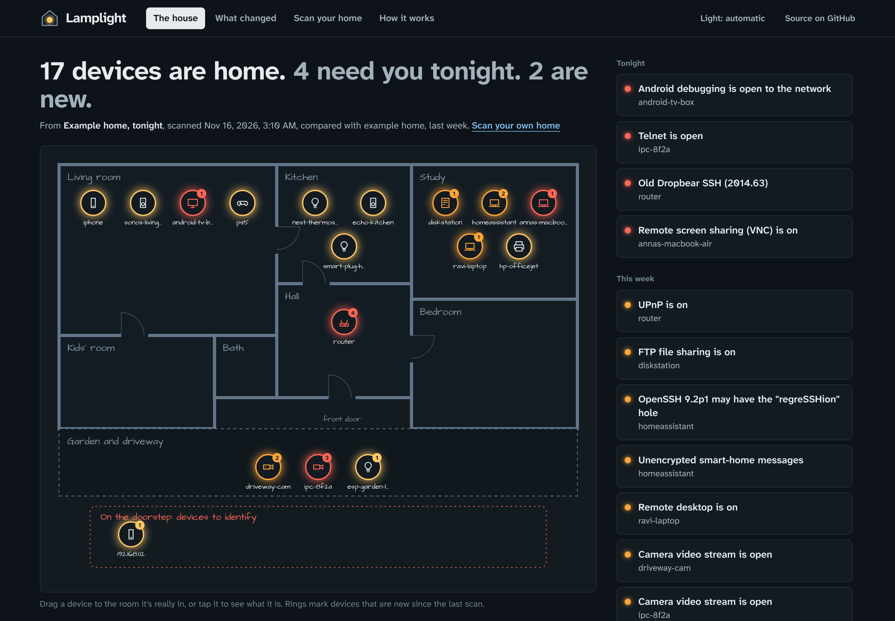
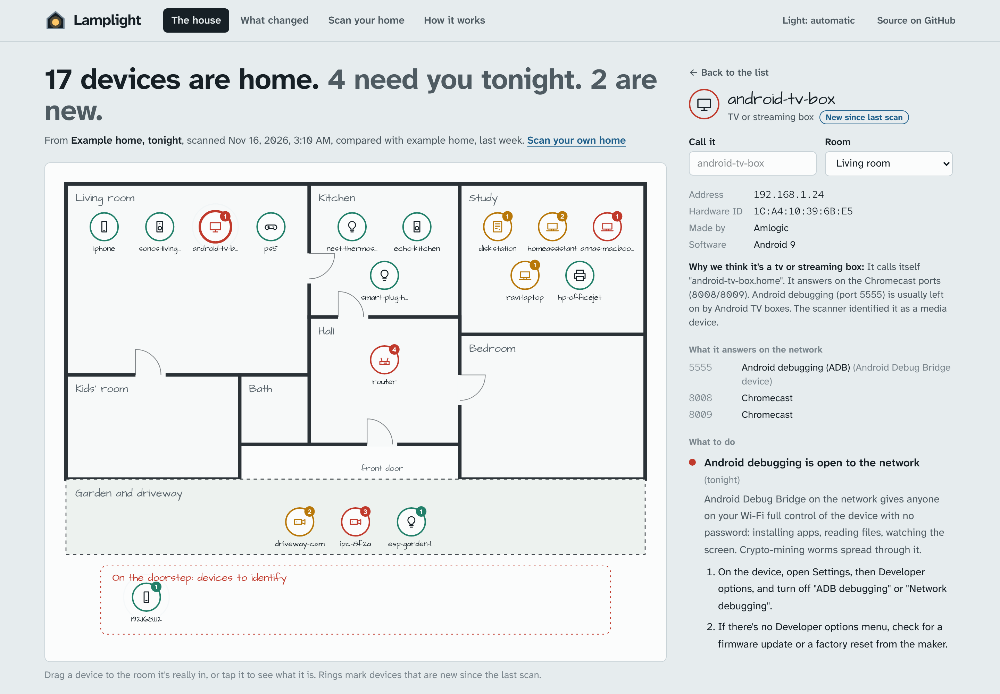
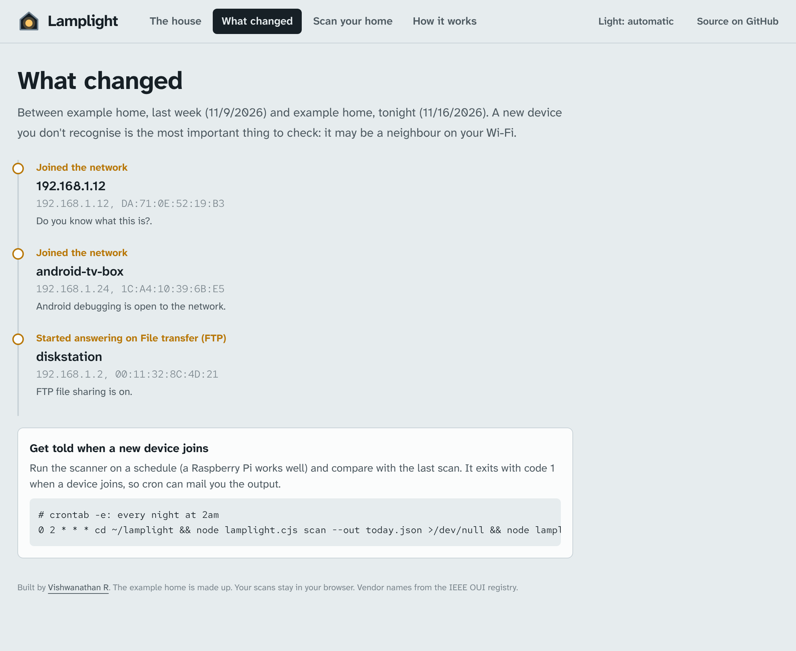

# Lamplight · Who's on your home network

> Built by [Vishwanathan R](https://vishwanathan.dev) · [Portfolio](https://vishwanathan.dev) · [Resume](https://vishwanathan.dev/resume.pdf)

Lamplight shows every device on your home network on a **floor plan of your house**. Risky devices glow red or amber, new ones get a ring, and anything nobody recognises waits **on the doorstep**. Tap a device to see what it is, why Lamplight thinks so, and exactly what to do, in plain English written for the person who looks after the family Wi-Fi rather than a security engineer.



## Why

Many homes now have more than a dozen connected devices, and few people could name them all. Cheap cameras ship with Telnet and a factory password, Android TV boxes arrive with debugging switched on, and routers leave UPnP open so any gadget can punch a hole to the internet. Botnets like Mirai are built from exactly these devices. Network scanners can find all of this, but their output (port numbers and service names) means nothing to most people. Lamplight turns a scan into a picture of your house and a short to-do list.

## What it does

- **Finds the devices.** A small scanner (one file, Node 20+) checks your network, or you can open an `nmap -oX` file, or just paste the output of `arp -a`.
- **Works out what each one is.** It looks up the maker in the IEEE MAC address registry (about 40,000 entries), reads the device's own name and the services it answers on (554 is a video stream, 9100 a printer, 62078 an iPhone), and shows the clues it used and how sure it is. Phones and laptops that hide behind a random "private" MAC address are recognised as such.
- **Puts it in a room.** Devices go where their name says (`echo-kitchen`, `driveway-cam`) or where that kind of device usually lives. Drag them to the right room; Lamplight remembers.
- **Says what to fix, and when.** "Tonight" for critical problems (Telnet on a camera, Android debugging on a TV box, software with a notorious hole), "this week" for things like UPnP on the router or an open camera stream, and network-wide advice such as moving gadgets to the guest network. Every item has steps someone without a networking background can follow.
- **Notices change.** Compare two scans to see who joined, who left, and what started answering. The scanner exits with code 1 when a new device joins, so a nightly cron job can email you.





## Try it

The live demo shows a made-up family home scanned twice, a week apart. Since then, an Android TV box has joined with debugging left on, the NAS has started serving FTP, and an unidentified phone is on the doorstep. The demo goes through the same nmap parser as a real scan.

To see your own home, open **Scan your home**:

```bash
# The Lamplight scanner: finds your network by itself, about a minute
node scanner/lamplight.cjs scan

# Or nmap, if you have it
sudo nmap -sV -O -oX scan.xml 192.168.1.0/24

# Or just the devices your computer has seen (Windows, Mac, Linux)
arp -a
```

Then choose the file, or paste the text. It is read in your browser and stored only in your browser.

## The scanner

`scanner/lamplight.cjs` is a single file with no dependencies, built from `packages/scanner`.

```bash
node scanner/lamplight.cjs scan [--network 192.168.1.0/24] [--out scan.json]
node scanner/lamplight.cjs report scan.json        # what to fix, in the terminal
node scanner/lamplight.cjs compare last.json scan.json
```

How it scans:

1. It tries a TCP connection to 39 ports chosen for homes (risky services, plus ones that identify a device) on every address, 256 at a time. A device that answers **or refuses** is there.
2. It reads short banners (SSH, Telnet, FTP) and HTTP `Server` headers to learn the software.
3. It sends a UPnP discovery message; a router that answers as an Internet Gateway Device has UPnP switched on.
4. It reads the ARP table for hardware addresses, does reverse DNS for names, and finds the router from the default route.

It **refuses public addresses** and ranges larger than /22, and never tries to log in to anything. Only scan networks you own or are allowed to test.

To run it nightly and get an email when something joins:

```cron
0 2 * * * cd ~/lamplight && node lamplight.cjs scan --out today.json >/dev/null && node lamplight.cjs compare last.json today.json; mv today.json last.json
```

Or in Docker, on the host's network:

```bash
docker build -t lamplight .
docker run --rm --network host -v "$PWD:/out" -w /out lamplight scan
```

## How it decides

| Finding | When | Why it matters |
| --- | --- | --- |
| Telnet open | Tonight | Plain-text remote login with factory passwords: how Mirai spreads |
| Android debugging (port 5555) | Tonight | Full control of the device with no password |
| Known-bad software | Tonight | vsftpd 2.3.4 (backdoor), Samba 3.5.0 to 4.6.4 (SambaCry), Dropbear before 2016.74, OpenSSH 8.5p1 to 9.7p1 (regreSSHion) |
| VNC screen sharing | Tonight | Remote control of the screen, often with a weak password |
| UPnP on the router | This week | Any device can open your router to the internet |
| FTP, camera streams, unencrypted MQTT, open databases, file sharing on gadgets | This week | Readable or controllable by anything on the Wi-Fi |
| Router or gadget settings page without HTTPS | When you have a minute | The admin password crosses the network in plain text |
| Device nobody can identify | When you have a minute | It might not be yours |
| Three or more gadgets next to your computers | Network advice | One hacked gadget can reach everything; use the guest network |

Judgement depends on the device: file sharing is normal on a NAS and odd on a light bulb. Version checks are deliberately few and certain. Where Linux distributions fix a bug without changing the version number (OpenSSH on Debian, for example), the finding says so and is marked less urgent.

## Run it

Requires Node 22.13+.

```bash
npm install
npm run dev          # the site on :5173
npm test             # 17 unit tests: parsers, vendor lookup, classification, checks, comparison, scanner
npm run test:e2e     # browser tests (Playwright)
npm run build        # the site and scanner/lamplight.cjs
```

The vendor table is generated from the IEEE registry (via the `oui-data` package) by `npm run oui`.

### Live demo on Vercel

Import the repository into Vercel. `vercel.json` builds the static site; everything runs in the browser and no keys are needed.

## Limits

- A website can't see your home network, so the scan has to run on a computer in the house.
- Lamplight doesn't test passwords. It tells you where a default password is likely to matter.
- Devices that ignore connections (most phones) show up with nothing open. That is good for them, but it also means less to identify them by.
- It looks at your network from inside. What your router exposes to the internet needs a check from outside, or a look at its port-forwarding settings.
- Device type is a weighted guess from public clues. Each device shows which clues were used, and you can correct the room and name.

## Tech stack

TypeScript · React 19 · Vite 6 · Tailwind CSS 4 · Node (net, dgram, dns) · esbuild · Vitest · Playwright · Docker · GitHub Actions

## Licence

MIT. Vendor names come from the IEEE OUI registry via [oui-data](https://github.com/silverwind/oui-data) (BSD-2-Clause).
