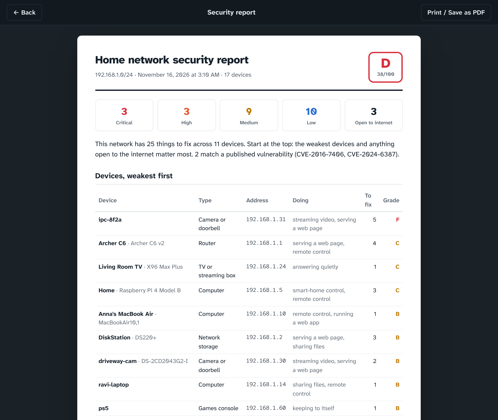
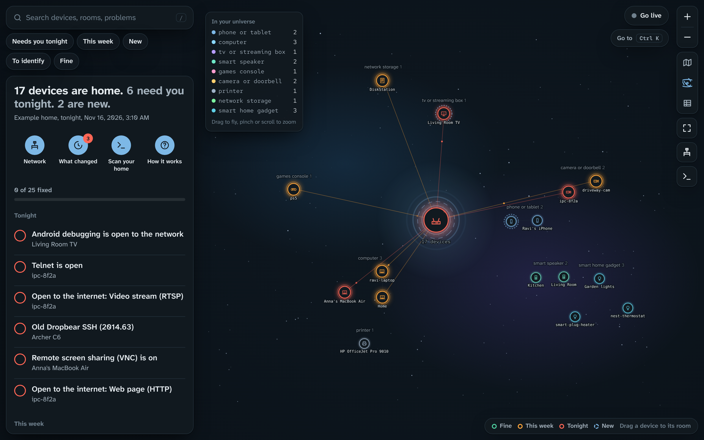
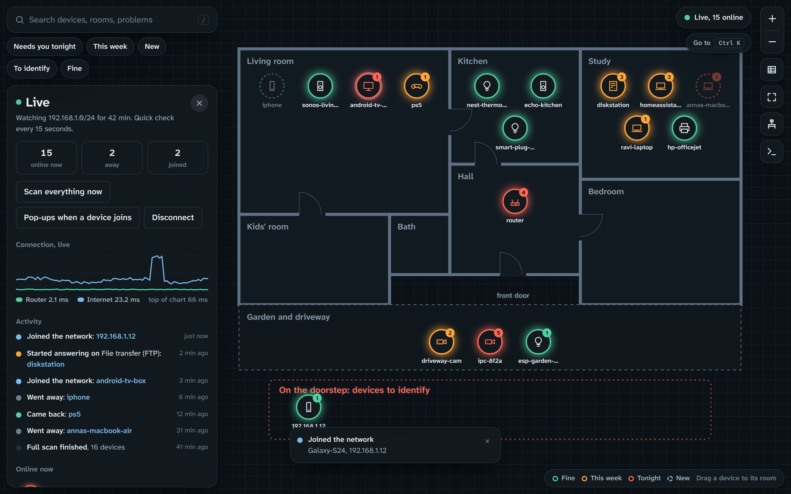
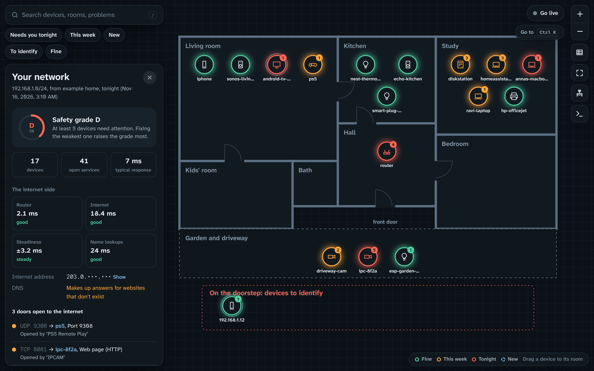
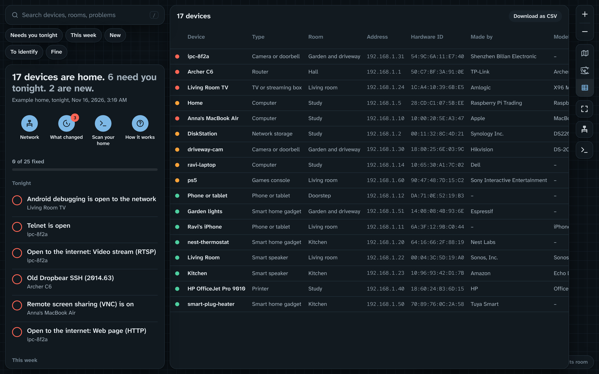
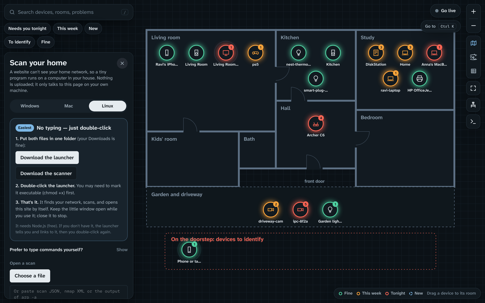
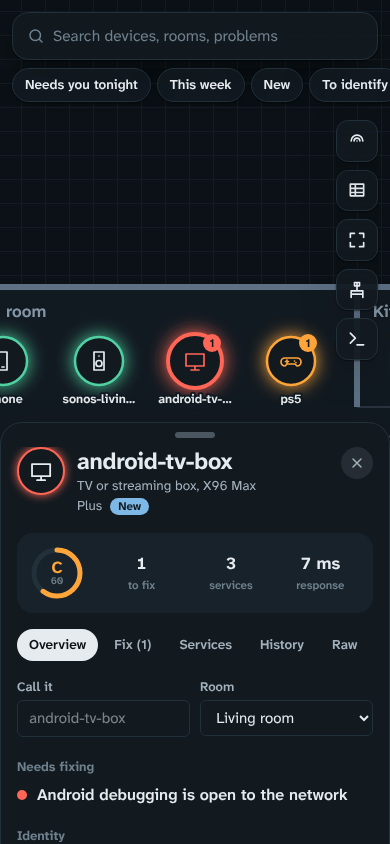

# Lamplight · Who's on your home network

**[Live demo →](https://home-network-guardian.vercel.app)** (a synthetic example home; nothing to install)

**The problem.** A typical home now has more connected gadgets than anyone can name, and the risky ones (a camera with Telnet and a factory password, a TV box with debugging left on, a router punching holes to the internet) look exactly like the safe ones. Network scanners can find all of this, but they answer in port numbers.

**Who it's for.** The person who looks after the family Wi-Fi, not a security engineer.

**Why it's different.**
- **A picture, not a port list.** Your home is a night sky (the router is the bright core, every device a star) or a floor plan of your house. Risky devices burn amber or red, unknown ones wait on the doorstep, and every fix comes in plain English with a "tonight / this week" urgency.
- **Nothing leaves your computer.** The scanner is one dependency-free file that serves the whole app from `127.0.0.1`. Scan data sits behind a per-session key, the page refuses DNS-rebinding, and no other website can read it.
- **Proves, doesn't guess.** Read-only checks confirm the worst problems (a camera stream with no password, anonymous FTP, SMBv1) and mark them **Checked**; version-based CVE matches are marked **Possible**.

**Measured, not estimated** (the demo build served locally by `vite preview`, so no internet latency; headless Chromium on a cloud Linux machine; median of 7 cold loads; reproduce with `npm run measure`):

| | Fast machine | 4× CPU slowdown |
|---|---|---|
| First paint | 212 ms | 468 ms |
| Home headline on screen | 224 ms | 710 ms |
| Transferred on first visit | 533 KB | 533 KB |

The app's JavaScript is 139 KB gzipped; the vendor table behind it covers 40,497 MAC prefixes from the IEEE registry. 65 unit tests and 12 end-to-end tests run on every push, the end-to-end ones under the production Content-Security-Policy.

## What it is

Lamplight shows every device on your home network on a **floor plan of your house**. Risky devices glow red or amber, new ones get a ring, and anything nobody recognises waits **on the doorstep**. Tap a device to see what it is, why Lamplight thinks so, and exactly what to do, in plain English written for the person who looks after the family Wi-Fi rather than a security engineer.

It works like a maps app, except the map is your house: the plan fills the screen, you drag and pinch to move around it, a search box and filters float on top, and the details slide up in a sheet.


## Why

Many homes now have more than a dozen connected devices, and few people could name them all. Cheap cameras ship with Telnet and a factory password, Android TV boxes arrive with debugging switched on, and routers leave UPnP open so any gadget can punch a hole to the internet. Botnets like Mirai are built from exactly these devices. Network scanners can find all of this, but their output (port numbers and service names) means nothing to most people. Lamplight turns a scan into a picture of your house and a short to-do list.

## What it does

- **Runs entirely on your computer.** The scanner (one file, Node 20+) has the whole app built in. `lamplight live` serves it from `http://127.0.0.1` on your own machine, so there's no outside website to trust, it works offline, and none of your data leaves the computer. It only answers to its own address (which blocks DNS-rebinding tricks), and the scan data needs the private key in the link it prints. You can still open an `nmap -oX` file, or paste the output of `arp -a`, in the hosted demo.
- **Finds the devices, fast.** A quick knock on every address plus the computer's ARP table finds who's home (even silent phones) in a few seconds; only those devices get the full check.
- **Works out what each one is.** It looks up the maker in the IEEE MAC address registry (about 40,000 entries), reads the device's own name and the services it answers on (554 is a video stream, 9100 a printer, 62078 an iPhone), and shows the clues it used and how sure it is. Phones and laptops that hide behind a random "private" MAC address are recognised as such.
- **Puts it in a room.** Devices go where their name says (`echo-kitchen`, `driveway-cam`) or where that kind of device usually lives. Drag them to the right room; Lamplight remembers.
- **Says what to fix, and when.** "Tonight" for critical problems (Telnet on a camera, Android debugging on a TV box, software with a notorious hole), "this week" for things like UPnP on the router or an open camera stream, and network-wide advice such as moving gadgets to the guest network. Every item has steps someone without a networking background can follow.
- **Peek at a camera (and any device's page).** A browser can't reach your devices, but the scanner can, so in live mode Lamplight fetches a camera's snapshot and shows it right in the app. If a camera has no password you see its picture, the plainest proof that it needs fixing; otherwise it shows the device's own page and a one-click link to open it. Works for printers, NAS admin pages and routers too.
- **Watches live.** Run `lamplight live` and the map updates as it happens: devices that join, go away and come back, services that start answering, and a live chart of how fast the router and the internet answer. New devices pop up on screen (and as desktop notifications if you want). The site talks only to the scanner on your own computer, with a private key from the link it prints.
- **Checks the router's doors to the internet.** It asks the router over UPnP which ports it has opened to the internet and for which device, the same list hidden in the router's settings, and flags a camera or computer reachable from outside. It also notices when your provider shares one internet address between homes (carrier-grade NAT), and when the router's DNS makes up answers for websites that don't exist.
- **Measures the connection.** Router and internet response times, how steady they are, and how long name lookups take.
- **Finds out more than who's there.** The scanner asks each device about itself the way phones and computers do every day: Bonjour gives the name its owner gave it ("Living Room TV") and its model, UPnP gives the router's make and model, NetBIOS gives Windows computer names, and it reads each web page's title, whether it asks for a password, and each HTTPS certificate (who issued it, when it expires). It also times how fast each device answers.
- **Opens every device like a profile.** Tabs for an overview (identity, what it announces, why Lamplight thinks it's what it is, and how sure), what to fix, the services it answers on, its history across scans, and the raw data. Each device and the whole network get a safety grade from A to F.
- **Shows the whole network.** The grade, the router, the weakest devices, what's on the network, who made it all and which services answer, plus a report you can download and keep.
- **Keeps a to-do list.** Tick a problem off when you've fixed it: the device's badge on the plan updates and a progress bar shows how far you've got.
- **Names devices by what they are.** Cheap smart bulbs and plugs all share one chip maker ("Espressif"), so instead of a wall of identical names Lamplight labels them by type and numbers them — "Smart home gadget 3" — and uses the real name when a device announces one ("Living Room TV"). Each device shows its model and, in a word, what it's busy doing (streaming, printing, sharing files).
- **A shareable security report.** One click opens a clean, printable report of the whole home — an A–F grade, a count of problems by seriousness, the weakest devices, and every fix. Save it as a PDF from your browser or share the page.
- **Known-vulnerability (CVE) checks, honestly labelled.** When a device's software banner matches a published hole, Lamplight names it with its CVE id and links to the public database. These are marked **Possible**, because makers sometimes fix a flaw without changing the version number; the fix is always to update.
- **Proves the worst problems instead of guessing.** Safe, read-only checks that never use or guess a password: does a camera describe its video stream to anyone who asks without a password, does an FTP server let in the public "anonymous" guest (it leaves at once and opens nothing), and does a device still speak SMBv1, the protocol WannaCry spread through. Proven findings are marked **Checked**.
- **Checks how your Wi-Fi is locked.** It asks your own computer whether the Wi-Fi uses WPA3, WPA2, the old WPA, WEP or no password, and says what to change.
- **Links slowdowns to devices.** In live mode, when the internet suddenly gets much slower than usual, it says so and names the device that joined just before.
- **No command line needed.** You download one tiny launcher (built in your browser, pointed at your own site). Double-click it: the first run fetches the scanner itself, finds your network, scans, and opens the site. No typing, and nothing to lose track of. The terminal commands are still there for anyone who wants them.
- **A universe view (the default).** The home opens as a little universe you fly around: your router is a glowing arc-reactor core, and every device is a star scattered through space in loose constellations of its own kind, each kind its own colour, with its real name under it when it shared one. Devices that need attention burn amber or red and send packets of data to the core. Drag to fly, pinch or scroll to zoom, hover any star for what it is and what it's doing. The house plan and table are a tap away.
- **Finds things fast.** Search by name, maker, room, address or problem ("camera", "kitchen", "telnet"), or tap a filter like *Needs you tonight* or *To identify*. Everything else on the plan fades out. Ctrl K jumps to any device or action, and a table view lists every device side by side, sortable and downloadable as CSV.
- **Notices change.** Compare two scans to see who joined, who left, and what started answering. The scanner exits with code 1 when a new device joins, so a nightly cron job can email you.
















## Try it

On the first visit a short briefing explains the idea over the example home; **Show me tonight's worst problem** opens the riskiest device on the plan, and **What is Lamplight?** (or the Ctrl K menu) brings it back. **How it works** follows one device from the current scan through the four steps (finding it, working out what it is, deciding what matters, proving the worst problems) with that device's real data at each step.

The live demo shows a made-up family home scanned twice, a week apart. Since then, an Android TV box has joined with debugging left on, the NAS has started serving FTP, and an unidentified phone is on the doorstep. The demo goes through the same nmap parser as a real scan.

To see your own home, tap **Scan your home**:

```bash
# The Lamplight scanner: finds your network by itself, about a minute
node scanner/lamplight.cjs scan

# Or nmap, if you have it
sudo nmap -sV -O -oX scan.xml 192.168.1.0/24

# Or just the devices your computer has seen (Windows, Mac, Linux)
arp -a
```

Then choose the file, or paste the text. It is read in your browser and stored only in your browser.

## The scanner

`scanner/lamplight.cjs` is a single file with no dependencies, built from `packages/scanner`. Every build also writes `scanner/lamplight.cjs.sha256`; the site serves both, shows the fingerprint next to the download command, and gives a one-line check for Windows, macOS and Linux. The build is byte-identical on every OS, so anyone can rebuild it and compare.

```bash
node lamplight.cjs networks                        # which networks this computer is on
node lamplight.cjs scan [--network 192.168.1.0/24] [--out scan.json]
node lamplight.cjs report scan.json                # what to fix, in the terminal
node lamplight.cjs compare last.json scan.json     # who joined, what opened
node lamplight.cjs live                            # keep watching, and see it live on the site
node lamplight.cjs demo                            # the example home, to try it without scanning
```

The site's **Scan your home** panel leads with two lines to paste (download the file, run `lamplight live`), says plainly what they do, and links to the source so you can read it first. A double-click launcher is offered as a second way; some Windows setups (Smart App Control) block unsigned downloads. Nothing is ever piped straight into a shell.

Add `--gentle` to scan slowly, for small or fussy routers and mesh Wi-Fi.

How it scans:

1. It picks the network your router is on, skipping virtual adapters from VirtualBox, VMware, Hyper-V, WSL and Docker.
2. It knocks on a dozen common ports on every address, then reads the ARP table, which lists even phones that ignore knocks. Only the devices it found get a TCP connection to 39 ports chosen for homes (risky services, plus ones that identify a device), 160 at a time (32 with `--gentle`). A device that answers **or refuses** is there, and the time it takes is its response time.
3. It reads short banners (SSH, Telnet, FTP), and for web ports the page's title, its `Server` header and whether it has a login form. For HTTPS ports it reads the certificate.
4. It asks each device its name six ways: Bonjour (to the whole network and to each device directly, which gets past firewalls that drop group replies), a direct reverse lookup on the device's own Bonjour port (iPhones and Macs answer it), NetBIOS, LLMNR (Windows laptops), UPnP descriptions, and the computer's own name lookup.
5. For a camera stream, an FTP server or Windows file sharing, it runs the safe checks above.
6. It reads the ARP table for hardware addresses, asks the router's DNS for names, finds the router from the default route, and asks the computer how the Wi-Fi is locked.
7. It asks the router (UPnP Internet Gateway Device) for its internet address and its list of port forwards, times connections to the router and to two public servers, and asks the router's DNS for a name that can't exist to see if it makes one up.

In **live mode** a quick check every 15 seconds (a knock on a few common ports, then the ARP table, which catches phones that ignore knocks) notices devices arriving and leaving; a device has to miss three checks in a row to count as gone, because Wi-Fi devices doze. A full scan runs every 10 minutes and soon after anything new joins. The app is served from `http://127.0.0.1:47114` on this computer; the scan data there only goes to requests carrying the key in the printed link. If the internet suddenly slows to several times its usual speed, it reports it and names the device that joined just before. On Windows, don't click inside the scanner's window: Windows pauses a program while text is selected in it.

It **refuses public addresses** and ranges larger than /22, and never uses or guesses a password. Only scan networks you own or are allowed to test.

To run it nightly and get an email when something joins:

```cron
0 2 * * * cd ~/lamplight && node lamplight.cjs scan --out today.json >/dev/null && node lamplight.cjs compare last.json today.json; mv today.json last.json
```

Or in Docker, on the host's network:

```bash
docker build -t lamplight .
docker run --rm --network host -v "$PWD:/out" -w /out lamplight scan
```

## How it decides

| Finding | When | Why it matters |
| --- | --- | --- |
| Telnet open | Tonight | Plain-text remote login with factory passwords: how Mirai spreads |
| Android debugging (port 5555) | Tonight | Full control of the device with no password |
| Camera stream plays without a password (checked) | Tonight | Anyone on the Wi-Fi can watch it in a free video player |
| FTP lets in the anonymous guest (checked) | Tonight | Anyone on the Wi-Fi can browse and copy what it shares |
| Wi-Fi with no password or WEP | Tonight | Anyone in range can join or break in within minutes |
| Known-bad software (possible) | Tonight | vsftpd 2.3.4 (backdoor), Samba 3.5.0 to 4.6.4 (SambaCry), Dropbear before 2016.74, OpenSSH 8.5p1 to 9.7p1 (regreSSHion) |
| SMBv1 still on (checked) | This week | The protocol WannaCry and NotPetya spread through |
| VNC screen sharing | Tonight | Remote control of the screen, often with a weak password |
| UPnP on the router | This week | Any device can open your router to the internet |
| FTP, camera streams, unencrypted MQTT, open databases, file sharing on gadgets | This week | Readable or controllable by anything on the Wi-Fi |
| Router or gadget settings page without HTTPS | When you have a minute | The admin password crosses the network in plain text |
| Device nobody can identify | When you have a minute | It might not be yours |
| Three or more gadgets next to your computers | Network advice | One hacked gadget can reach everything; use the guest network |

Judgement depends on the device: file sharing is normal on a NAS and odd on a light bulb. Version checks are deliberately few, and labelled as possible. Where Linux distributions fix a bug without changing the version number (OpenSSH on Debian, for example), the finding says so and is marked less urgent.

## Run it

Requires Node 22.13+.

```bash
npm install
npm run dev          # the site on :5173
npm test             # 57 unit tests: parsers, vendor lookup, classification, checks, safe probes, the scanner and its built-in app
npm run test:e2e     # browser tests (Playwright)
npm run build        # the site and scanner/lamplight.cjs
```

The vendor table is generated from the IEEE registry (via the `oui-data` package) by `npm run oui`.

### Live demo on Vercel

Import the repository into Vercel. `vercel.json` builds the static site; everything runs in the browser and no keys are needed.

## Limits

- A website can't see your home network, so the scan has to run on a computer in the house.
- Lamplight doesn't test passwords. It tells you where a default password is likely to matter.
- Devices that ignore connections (most phones) show up with nothing open. That is good for them, but it also means less to identify them by.
- It looks at your network from inside. What your router exposes to the internet needs a check from outside, or a look at its port-forwarding settings.
- Device type is a weighted guess from public clues. Each device shows which clues were used, and you can correct the room and name.

## Tech stack

TypeScript · React 19 · Vite 6 · Tailwind CSS 4 · Node (net, dgram, dns) · esbuild · Vitest · Playwright · Docker · GitHub Actions

## Licence

MIT. Vendor names come from the IEEE OUI registry via [oui-data](https://github.com/silverwind/oui-data) (BSD-2-Clause).
